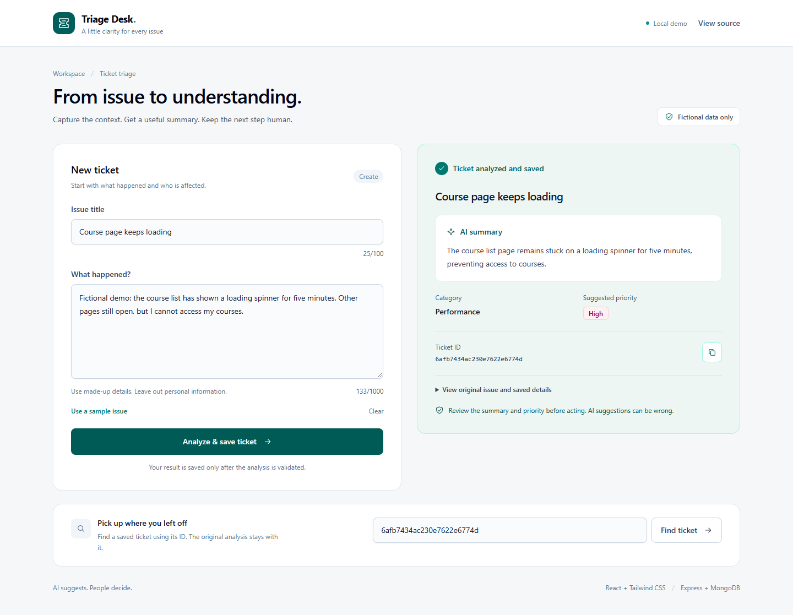

# Triage Desk

[Open the live demo](https://triage-desk-mehedi.onrender.com/) · Fictional reports only. The free service can take about a minute to wake after inactivity.

A small React workspace that summarizes fictional support issues, suggests a category and priority with Gemini, and saves validated results in MongoDB. Priority is advisory and needs human review.

**Implemented:** a focused create/find workspace, three example reports, loading/error states, a saved-analysis pane, copyable ticket ID and saved-ticket lookup. Field errors focus the invalid input; successful requests reveal the result on mobile. The Express API handles input/output validation, AI analysis, persistence and safe failures. All 28 automated tests pass. Render Free deployment is supported with a persistent daily AI budget and a health endpoint. [Deployment guide](docs/deployment.md).

A learning project directed by Mehedi Hasan. The implementation and tests were developed with an AI coding assistant; the walkthroughs document the code for study and review. Uses React, Tailwind CSS, Vite, JavaScript ES modules, Express 5, MongoDB/Mongoose, Zod 4 and the Gemini REST API. [Backend walkthrough](docs/walkthrough.md) · [Frontend walkthrough](docs/frontend.md).



```text
React form -> Express -> Zod -> Gemini -> Zod -> MongoDB -> React result
```

## Run

Node.js 22.12+ (tested on 22.13.1), npm 11.4.0 and a usable MongoDB connection are required.

Clone the repository:

```bash
git clone https://github.com/mehedi2486/ai-support-ticket-triage.git
cd ai-support-ticket-triage
```

1. Run `npm ci --ignore-scripts`.
2. Copy `.env.example` to `.env` if no local environment file exists. Set GEMINI_API_KEY and MONGODB_URI locally. Keep them out of Git and chats. The verified model setting is gemini-3.5-flash-lite.
3. Stop an older server in its own terminal before starting another instance on port 3001.
4. Run `npm run build` to build the React frontend.
5. Run `npm start`, then open [Triage Desk](http://127.0.0.1:3001).

The server waits for MongoDB and defaults locally to http://127.0.0.1:3001. It serves the built frontend and API from the same origin and uses the `triage_lab` database. Optional PORT overrides the port. Production uses `0.0.0.0`; HOST can be set explicitly. If GET / returns JSON 404, run the build and restart the server. The entry file loads `.env` when present; cloud environment variables work without that file.

In **New ticket**, choose an example or enter a fictional report, then **Analyze & save**. Use **Copy ID** to keep the returned ID. Switch to **Find ticket** and choose **Retrieve ticket** to read the stored analysis without another model call. **Clear draft** clears the report inputs and keeps the saved analysis available.

For development, run `npm run dev` in one terminal and `npm run dev:frontend` in another. Open the Vite URL printed in the second terminal. Its `/tickets` proxy expects the backend on port 3001. Build again before viewing frontend changes through Express.

## Try it in Git Bash, macOS or Linux

Keep the server running. In a second terminal:

```bash
curl -i -X POST "http://127.0.0.1:3001/tickets" \
  -H "Content-Type: application/json" \
  --data '{"title":"Course page stuck","body":"Fictional demo: the course list keeps loading, but other pages work."}'
```

Expect **201 Created**. An illustrative response (actual ID, timestamps and generated text vary):

```json
{
  "ticket": {
    "title": "Course page stuck",
    "body": "Fictional demo: the course list keeps loading, but other pages work.",
    "summary": "The course list keeps loading while other pages work normally.",
    "category": "bug",
    "priority": "medium",
    "model": "gemini-3.5-flash-lite",
    "_id": "507f1f77bcf86cd799439011",
    "createdAt": "2026-11-17T00:00:00.000Z",
    "updatedAt": "2026-11-17T00:00:00.000Z"
  }
}
```

Use the actual `_id` from your response:

```bash
curl -i "http://127.0.0.1:3001/tickets/YOUR_TICKET_ID"
```

Expect **200 OK** with the stored ticket. GET reads MongoDB without calling Gemini again.

For PowerShell:

```powershell
$payload = @{ title = "Course page stuck"; body = "Fictional demo: the course list keeps loading." } | ConvertTo-Json
Invoke-RestMethod -Uri "http://127.0.0.1:3001/tickets" -Method Post -ContentType "application/json" -Body $payload
```

## Routes

| Method | Path | Behavior |
| --- | --- | --- |
| POST | /tickets | Validate title/body, request AI analysis, validate its output and save; return 201 with `{ticket}` |
| GET | /tickets/:id | Return `{ticket}` with 200; malformed ID 400, absent ticket 404 |
| GET | /health | Return 200 when database-ready, otherwise 503; no model request or secret details |

POST JSON example:

```json
{"title":"Course page keeps loading","body":"The course list shows a spinner for five minutes. Other pages work."}
```

A ticket contains `_id`, trimmed title/body, summary, category, priority, model, createdAt and updatedAt. Categories: access, performance, bug, other. Priorities: low, medium, high.

Input limits: title 1-100 characters and body 1-1000 after trimming, strings only, request body 8 KB. Unknown input fields are discarded; callers cannot set priority by adding a field. Errors are JSON: 400 invalid input/JSON, 413 oversized body, 429 local demo usage limit, 502 bad upstream/output, 503 unavailable/rate-limited AI, 504 timeout, 500 unexpected storage failure.

## Structure

```text
server.js                 configuration, DB connection and listening
app.js                    Express setup and error responses
frontend/src/App.jsx      form state, submission and saved-ticket lookup
frontend/src/TicketResult.jsx  empty/loading/result views and copy ID
frontend/src/api.js        browser requests with timeouts
frontend/src/index.css     Tailwind styling and focus/reduced-motion rules
frontend/vite.config.js   build and local development API proxy
routes/tickets.js         POST and GET handlers
db.js                     Mongoose ticket model and connection
ticket-schema.js          Zod input schema
services/triage.js         Gemini request and Zod output validation
services/demo-quota.js     atomic daily model-attempt reservations
config.js                 optional local env file and runtime configuration
render.yaml               one free Render web service, manual deployment
scripts/                  connection and live-flow checks
tests/                    local HTTP tests with fixture storage/AI
docs/walkthrough.md       request flow and key concepts
docs/frontend.md          frontend flow and basic React concepts
```

## Verification

- `npm test`: 28 passing tests, using real local HTTP plus explicit fixture storage/AI; service tests use simulated fetch responses. Includes cloud configuration, daily quota boundaries/concurrency, fail-closed behavior, health checks, frontend serving, security headers, missing builds and environment-file isolation.
- `npm run build`: creates ignored `frontend/dist`; Express serves only that directory.
- Browser checks: real Gemini/MongoDB creation (201) and saved lookup (200), field-specific whitespace/ID validation and focus, absent ticket, clipboard contents/details, draft preservation, loading/disabled controls and a simulated provider 503. Desktop 1440px, tablet 768px and mobile 390/320px layouts had no horizontal overflow or browser console errors. Mobile results were revealed after success; long unbroken content and HTML-as-text were checked. [Redesign verification](docs/ui-verification.md). Automated DOM checks do not replace assistive-technology testing.
- An intermittent Windows test failure was traced to `listen(0)` assigning a fetch-blocked low port (observed 3659). Test listeners now choose available high ports; 20 repeated HTTP suites passed after the fix. No HTTP assertions are retried.
- `npm run check:ai`: one real synthetic model request.
- `npm run check:db`: read-only MongoDB ping.
- `npm run check:flow`: real API -> Gemini -> MongoDB creation, GET, process restart, GET again. This consumes provider quota and retains one clearly fictional demo ticket.
- The real-service flow passed during development: creation 201, retrieval 200, retrieval after restart 200. Generated evidence stays local and ignored by Git.
- Native npm audit reported zero known vulnerabilities at the implementation checkpoint. This is not a guarantee against every vulnerability.

## Limits and data handling

Use fictional tickets only. Free-tier provider quota varies, and free-tier content may be used to improve the provider's products. Credentials stay in the ignored local environment file; no raw provider or database errors are returned. The AI has no tools and cannot execute actions. Input/output schemas constrain structure, not the correctness of its judgment.

There are no users or authentication, agent, RAG, model training or automatic model retries. A ten-attempt-per-minute limiter is scoped to one process. A MongoDB counter also caps model attempts at25 per UTC day across restarts (DEMO_DAILY_LIMIT is configurable). An attempt is reserved before the model call and remains consumed on failure. If quota storage fails, no model call is made. Ticket records are written only after valid AI output; the quota counter is a separate write. A browser timeout does not guarantee the server stopped processing. Retrying POST can create another ticket; idempotency is outside this demo. Records remain until the database owner removes them; there is no deletion endpoint or ticket-list endpoint.

The public deployment is a fictional-data portfolio demo, not a private customer-support system. Anyone with a ticket ID can read that fictional record. Daily limits bound this app's model attempts, not other uses of the key or provider billing. Do not enter personal/customer data. Free hosting can sleep or reach usage limits; the deployment guide records those boundaries.

[Backend explanation](docs/walkthrough.md) · [Frontend explanation](docs/frontend.md)
